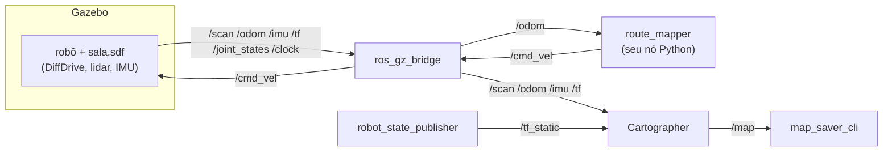
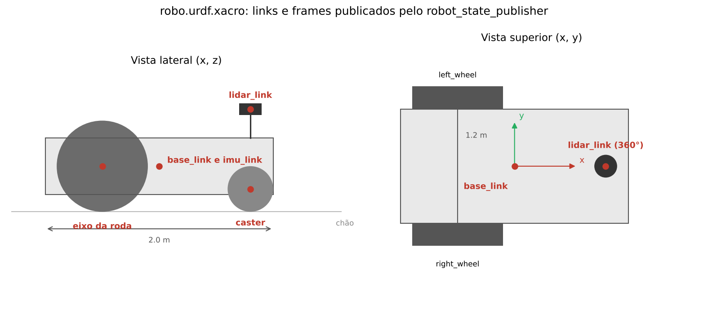
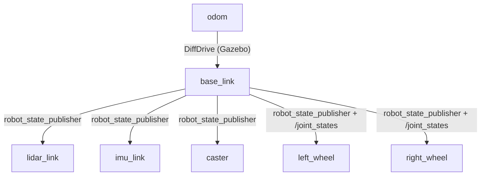
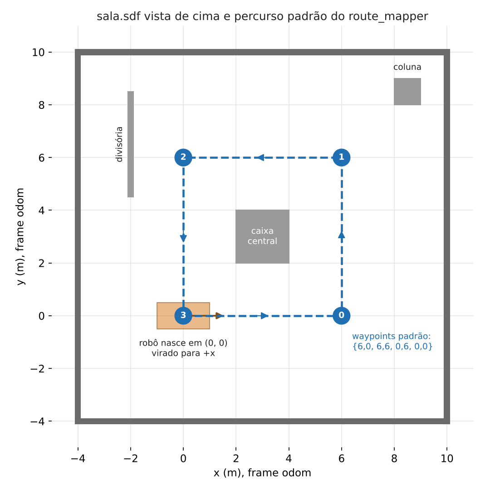

# Workshop ROS 2 Jazzy em Python: do TurtleBot3 ao mapeamento autônomo

Em 3 aulas de 2 h, você vai escrever nós Python para o ROS 2, construir no Gazebo um robô próprio com lidar, IMU e odometria, e fazê-lo mapear uma sala sozinho com o Cartographer, seguindo um percurso definido por você.

> Esta é a versão em **Python**, com todos os seus nós no pacote `robo_py`. A versão em C++ está no [README.md](README.md). Ambiente, Gazebo, xacro e Cartographer são os mesmos nas duas.

| Aula | Tema | Ao final você terá |
| --- | --- | --- |
| [1](#aula-1--ros-2-e-nós-python-com-o-turtlebot3) | ROS 2 e nós Python com o TurtleBot3 no Gazebo | Um nó que lê o lidar e desvia de obstáculos |
| [2](#aula-2--gazebo-o-seu-robô-com-lidar-e-imu) | Gazebo: do SDF ao xacro, com ponte para o ROS 2 | O seu robô no Gazebo, comandado e lido pelo ROS 2 |
| [3](#aula-3--slam-e-mapeamento-autônomo) | SLAM com o Cartographer | O mapa da sala feito pelo robô, sem ninguém dirigir |

O sistema que você terá montado no fim da Aula 3:



## Sumário

- [Estrutura do repositório](#estrutura-do-repositório)
- [Preparação do ambiente (antes da Aula 1)](#preparação-do-ambiente-antes-da-aula-1)
- [Trabalhando de casa e na faculdade](#trabalhando-de-casa-e-na-faculdade)
- [Alunos com Windows](#alunos-com-windows)
- [Aula 1 — ROS 2 e nós Python com o TurtleBot3](#aula-1--ros-2-e-nós-python-com-o-turtlebot3)
- [Aula 2 — Gazebo: o seu robô com lidar e IMU](#aula-2--gazebo-o-seu-robô-com-lidar-e-imu)
- [Aula 3 — SLAM e mapeamento autônomo](#aula-3--slam-e-mapeamento-autônomo)
- [Problemas comuns](#problemas-comuns)
- [Referências](#referências)

## Estrutura do repositório

Os arquivos marcados com **(você completa)** têm `TODO` para resolver; os marcados com **(você cria)** não existem ainda e são escritos durante a aula. O resto já vem pronto.

```
ros_workshop/
├── docker/
│   ├── Dockerfile                    # imagem ROS 2 Jazzy + Gazebo Harmonic + TurtleBot3 + Cartographer
│   ├── docker-compose.yaml           # contêiner ros_workshop (monta este repositório em ~/workshop_ws/src)
│   ├── docker-compose.nvidia.yaml    # opcional, só para GPU NVIDIA (Linux)
│   └── docker-compose.wsl.yaml       # opcional, só para Windows (WSL2)
├── .devcontainer/                    # opcional, VS Code: cpu/, nvidia/ e windows/
├── docs/img/                         # figuras deste README
├── maps/                             # mapas gerados na Aula 3 (.pgm + .yaml)
└── workshop/
    ├── comms/                        # talker/listener em Python: o código do tutorial da Aula 1, pronto
    ├── py_pubsub/                    # (você cria) pacote do tutorial publisher/subscriber, Aula 1
    ├── robo_description/             # o modelo do robô (Aula 2), usado pelas duas trilhas
    │   └── urdf/robo.urdf.xacro      # (você cria) o robô em xacro, com lidar e IMU
    ├── robo_gazebo/                  # a simulação do robô (Aula 2), usada pelas duas trilhas
    │   ├── worlds/
    │   │   ├── sala.sdf              # mundo com paredes usado no mapeamento
    │   │   └── building_robot.sdf    # (você cria) o robô do tutorial do Gazebo
    │   ├── config/bridge.yaml        # tópicos ligados entre Gazebo e ROS 2
    │   └── launch/sim.launch.py      # (você completa) TODO 1 e 2
    ├── robo_cartographer/            # o SLAM do robô (Aula 3), usado pelas duas trilhas
    │   ├── config/robo_2d.lua        # (você cria) configuração do Cartographer
    │   └── launch/cartographer.launch.py   # pronto: chama o turtlebot3_cartographer com o robo_2d.lua
    └── robo_py/                      # nós da trilha Python, Aulas 1 e 3
        ├── package.xml, setup.py, setup.cfg
        └── robo_py/
            ├── obstacle_avoider.py   # (você completa) TODO 1 a 4, Aula 1
            └── route_mapper.py       # (você completa) TODO 1 a 9, Aula 3
```

Os pacotes `ttbot` e `robo_lp` são da versão em C++ e não são usados aqui. Os três pacotes `robo_description`, `robo_gazebo` e `robo_cartographer` são compartilhados pelas duas trilhas.

O robô fica dividido em três pacotes, como o próprio TurtleBot3 (`turtlebot3_description`, `turtlebot3_gazebo`, `turtlebot3_cartographer`): o modelo, a simulação e o SLAM são compartilhados, e cada trilha só tem os seus nós.

Dentro do contêiner, este repositório aparece em `~/workshop_ws/src`. Tudo o que você cria ou edita ali fica salvo no seu computador, mesmo depois de apagar o contêiner.

## Preparação do ambiente (antes da Aula 1)

No Windows, siga antes a seção [Alunos com Windows](#alunos-com-windows). Você precisa de um Linux com [Docker Engine](https://docs.docker.com/engine/install/) e Docker Compose. O seu usuário deve estar no grupo `docker` (confira com `groups`); nos computadores da universidade, isso já vem configurado pela TI.

1. Clone o repositório e libere as janelas gráficas para o Docker. Se for trabalhar em mais de um computador (em casa e na faculdade), clone o seu fork no lugar deste: veja [Trabalhando de casa e na faculdade](#trabalhando-de-casa-e-na-faculdade).

   ```bash
   git clone https://github.com/gustavorvillela/ros_workshop.git
   cd ros_workshop
   xhost +local:docker
   ```

2. Construa a imagem (só na primeira vez; leva alguns minutos e baixa vários GB):

   ```bash
   docker compose -f docker/docker-compose.yaml build
   ```

3. Suba o contêiner com um `ROS_DOMAIN_ID` **único por computador**, por exemplo o número da sua bancada (de 1 a 100):

   ```bash
   ROS_DOMAIN_ID=12 docker compose -f docker/docker-compose.yaml up -d
   ```

   Com GPU NVIDIA, acrescente o segundo arquivo: `docker compose -f docker/docker-compose.yaml -f docker/docker-compose.nvidia.yaml up -d`.

4. Abra um terminal dentro do contêiner. **Repita este comando para cada terminal novo** que as aulas pedirem:

   ```bash
   docker exec -it ros_workshop bash
   ```

5. Compile o workspace e faça o teste de fumaça:

   ```bash
   cd ~/workshop_ws && colcon build --symlink-install && source install/setup.bash
   ros2 launch turtlebot3_gazebo turtlebot3_world.launch.py
   ```

   O Gazebo deve abrir com o TurtleBot3 Burger no meio de um campo de pilares.

No fim de cada aula, `docker compose -f docker/docker-compose.yaml down` desliga o contêiner. O seu código continua no repositório.

> **Sempre que mudar código ou adicionar arquivos**, recompile e recarregue o ambiente no terminal em que vai rodar: `cd ~/workshop_ws && colcon build --symlink-install && source install/setup.bash`. Para compilar só um pacote: `--packages-select robo_py`.

> **Python e `--symlink-install`:** depois do primeiro `colcon build`, mudanças nos `.py` valem na hora, sem recompilar. Recompile quando mudar o `setup.py` e sempre que **criar** arquivos nos pacotes compartilhados (xacro, `.lua`, `.sdf`): eles são instalados no momento do build.

> **VS Code (opcional):** com a extensão Dev Containers, use *Reopen in Container*. O VS Code usa o mesmo `docker-compose.yaml`.

## Trabalhando de casa e na faculdade

Para começar uma aula em casa e continuar na faculdade, use um **fork**: uma cópia deste repositório na sua conta do GitHub. Você envia o seu trabalho para o fork no fim de cada sessão e o baixa de volta no outro computador.

1. **Crie o fork (uma vez só).** Nesta página do GitHub, clique em **Fork** e depois em **Create fork**. O resultado é `github.com/SEU_USUARIO/ros_workshop`, e é ele que você clona daqui em diante.

2. **Crie um token para enviar código (uma vez só).** O GitHub não aceita a sua senha no `git push`. Em **Settings → Developer settings → Personal access tokens → Fine-grained tokens → Generate new token**, dê acesso só ao repositório `ros_workshop` do seu fork, com permissão **Contents: Read and write**. Guarde o token num lugar seguro: ele faz o papel da senha.

3. **Clone o seu fork** em cada computador, no lugar do repositório original, e siga a [Preparação do ambiente](#preparação-do-ambiente-antes-da-aula-1) normalmente:

   ```bash
   git clone https://github.com/SEU_USUARIO/ros_workshop.git
   ```

4. **No fim de cada sessão, envie o trabalho.** No terminal do computador (fora do contêiner), na pasta do repositório:

   ```bash
   git add -A
   git commit -m "Aula 1: obstacle_avoider"
   git push
   ```

   Quando o git pedir usuário e senha, use o seu usuário do GitHub e o token no lugar da senha.

5. **No começo de cada sessão, baixe o que enviou do outro computador:** `git pull`, na pasta do repositório.

6. **Receba as atualizações do professor.** Na página do seu fork, clique em **Sync fork → Update branch** e depois rode `git pull`.

   O mesmo pelo terminal, útil quando o botão avisa de conflito:

   ```bash
   git remote add upstream https://github.com/gustavorvillela/ros_workshop.git   # uma vez só
   git fetch upstream
   git merge upstream/main
   git push
   ```

   Use `merge`, e não `rebase`: o rebase reescreve os commits que você já enviou ao fork e obriga a um `git push --force`, o que bagunça o histórico se você trabalha em mais de um computador. Um conflito só aparece se o professor mudou as mesmas linhas que você (por exemplo, num arquivo com `TODO`). Nesse caso o git marca o trecho com `<<<<<<<` e `>>>>>>>`: escolha o que fica, salve e rode `git add <arquivo>`, `git commit` e `git push`. Na dúvida, fale com o professor antes.

   > Faça os comandos `git` sempre no terminal do computador, fora do contêiner: dentro dele os arquivos do `.git` passam a pertencer ao `root`, e o `git add` passa a falhar com `insufficient permission`.

> **Computadores da faculdade são compartilhados:** não deixe o token salvo neles. Se o git oferecer guardar a senha, recuse; se já tiver guardado, apague o arquivo `~/.git-credentials` antes de sair.

> **Computador de casa:** o ambiente foi preparado e testado no Linux. Windows (WSL2) e macOS não foram testados.


## Alunos com Windows

O ambiente roda no Windows pelo **WSL2**, que coloca um Ubuntu dentro do Windows, e pelo **WSLg**, que mostra as janelas do Gazebo e do RViz na sua área de trabalho. Depois de instalado, **todos os comandos deste README são digitados no terminal do Ubuntu**, não no PowerShell.

> Esta configuração ainda não foi testada pelo professor num computador com Windows. Se algo der errado, anote a mensagem de erro e avise.

**Você precisa de:** Windows 11 ou Windows 10 atualizado, virtualização ligada na BIOS (normalmente já vem ligada), pelo menos 8 GB de RAM e uns 30 GB livres no disco.

1. **Instale o WSL com o Ubuntu 24.04.** No PowerShell aberto como administrador:

   ```powershell
   wsl --install -d Ubuntu-24.04
   wsl --update
   ```

   Reinicie o computador se ele pedir. Depois abra o **Ubuntu 24.04** pelo menu Iniciar e crie o seu usuário e senha do Linux.

2. **Confira se as janelas e a placa de vídeo chegam ao Linux.** No terminal do Ubuntu:

   ```bash
   echo $DISPLAY      # deve mostrar :0
   ls /mnt/wslg       # deve listar arquivos, como weston.log
   ls /dev/dxg        # a placa de vídeo do Windows vista pelo Linux
   ```

   Se algum deles falhar, rode `wsl --update` e depois `wsl --shutdown` no PowerShell, e abra o Ubuntu de novo.

3. **Instale o Docker Engine dentro do Ubuntu**, seguindo o [guia oficial para Ubuntu](https://docs.docker.com/engine/install/ubuntu/), e libere o Docker para o seu usuário:

   ```bash
   sudo usermod -aG docker $USER
   ```

   Feche o terminal do Ubuntu e abra de novo: `docker run hello-world` deve funcionar sem `sudo`. Se o Docker não iniciar, confira se o arquivo `/etc/wsl.conf` tem as linhas `[boot]` e `systemd=true`, rode `wsl --shutdown` no PowerShell e abra o Ubuntu de novo. Se você já usa o Docker Desktop com a integração WSL ligada para o Ubuntu, ele também deve servir, mas não foi testado.

4. **Clone o repositório dentro do Ubuntu**, na sua pasta pessoal, e não no disco do Windows (`/mnt/c`): lá os arquivos ficam muito mais lentos e as permissões se confundem.

   ```bash
   cd ~
   git clone https://github.com/SEU_USUARIO/ros_workshop.git    # o seu fork, ou o original
   cd ros_workshop
   ```

5. **Suba o contêiner com o arquivo do Windows.** É o passo 3 da [Preparação do ambiente](#preparação-do-ambiente-antes-da-aula-1), com um arquivo a mais; o `xhost` não é necessário no WSLg:

   ```bash
   docker compose -f docker/docker-compose.yaml -f docker/docker-compose.wsl.yaml build
   docker compose -f docker/docker-compose.yaml -f docker/docker-compose.wsl.yaml up -d
   docker exec -it ros_workshop bash
   ```

   Daqui em diante siga a preparação e as aulas normalmente. Sempre que o README mandar subir ou desligar o contêiner, acrescente `-f docker/docker-compose.wsl.yaml`. O arquivo da NVIDIA não é usado no Windows: a placa de vídeo, de qualquer marca, chega ao contêiner pelo próprio WSL.

6. **Confira a placa de vídeo dentro do contêiner:**

   ```bash
   docker exec ros_workshop glxinfo -B | grep "OpenGL renderer"
   ```

   Deve aparecer `D3D12 (...)` com o nome da sua placa. Se aparecer `llvmpipe`, o desenho está sendo feito pela CPU: funciona, só que mais devagar.

**VS Code:** instale o VS Code no Windows com as extensões **WSL** e **Dev Containers**. No terminal do Ubuntu, dentro da pasta do repositório, rode `code .`; depois use *Reopen in Container* e escolha **ROS Workshop (Jazzy, Windows/WSL)**.

| Sintoma no Windows | Solução |
| --- | --- |
| `cannot open display` ou nenhuma janela aparece | `wsl --shutdown` no PowerShell, espere alguns segundos e abra o Ubuntu de novo |
| Gazebo com tela preta, travando ou fechando sozinho | Descomente `LIBGL_ALWAYS_SOFTWARE=1` em `docker/docker-compose.wsl.yaml` e recrie o contêiner (`down` e `up -d`) |
| Erro sobre `!override` ao subir o contêiner | Docker Compose antigo: atualize o Docker (precisa da versão 2.24.4 ou mais nova) |
| Computador lento, ou o Gazebo fecha por falta de memória | Crie o arquivo `C:\Users\SEU_USUARIO\.wslconfig` com as linhas `[wsl2]` e `memory=8GB`, e rode `wsl --shutdown` |

---

## Aula 1 — ROS 2 e nós Python com o TurtleBot3

**Objetivo:** escrever um nó Python que lê o lidar do TurtleBot3 simulado e publica velocidades para desviar de obstáculos.

**Conceitos:** nós, tópicos, mensagens, QoS, `rclpy`, `colcon`, `package.xml` e `setup.py`, `ros2` CLI, `rqt_graph`, `use_sim_time`.

### 1.1 Linha de comando

Siga [Understanding nodes](https://docs.ros.org/en/jazzy/Tutorials/Beginner-CLI-Tools/Understanding-ROS2-Nodes/Understanding-ROS2-Nodes.html) e [Understanding topics](https://docs.ros.org/en/jazzy/Tutorials/Beginner-CLI-Tools/Understanding-ROS2-Topics/Understanding-ROS2-Topics.html) com o turtlesim:

```bash
ros2 run turtlesim turtlesim_node            # terminal 1
ros2 run turtlesim turtle_teleop_key         # terminal 2
ros2 node list && ros2 topic list            # terminal 3
ros2 topic echo /turtle1/pose
rqt_graph
```

### 1.2 Primeiro pacote Python

Siga [Creating a package](https://docs.ros.org/en/jazzy/Tutorials/Beginner-Client-Libraries/Creating-Your-First-ROS2-Package.html) e [Writing a simple publisher and subscriber (Python)](https://docs.ros.org/en/jazzy/Tutorials/Beginner-Client-Libraries/Writing-A-Simple-Py-Publisher-And-Subscriber.html). **Onde criar:** dentro de `workshop/`, e não num workspace novo:

```bash
cd ~/workshop_ws/src/workshop
ros2 pkg create --build-type ament_python --license Apache-2.0 py_pubsub --dependencies rclpy std_msgs
# siga o tutorial colocando os .py em workshop/py_pubsub/py_pubsub/ e registrando-os no setup.py
cd ~/workshop_ws && colcon build --symlink-install --packages-select py_pubsub && source install/setup.bash
ros2 run py_pubsub talker      # terminal 1
ros2 run py_pubsub listener    # terminal 2
```

O código final do tutorial já está pronto em `workshop/comms` (`ros2 run comms talker` e `ros2 run comms listener`). Use-o para conferir o seu, principalmente o `entry_points` do `setup.py`: é ele que transforma um arquivo `.py` num executável do `ros2 run`.

### 1.3 TurtleBot3 no Gazebo

Baseado na [Simulation do e-Manual do TurtleBot3](https://emanual.robotis.com/docs/en/platform/turtlebot3/simulation/):

```bash
ros2 launch turtlebot3_gazebo turtlebot3_world.launch.py     # terminal 1
ros2 run turtlebot3_teleop teleop_keyboard                   # terminal 2
ros2 topic echo /scan --once                                 # terminal 3
ros2 topic info -v /cmd_vel
rqt_graph
```

Anote o **tipo** de mensagem que aparece em `ros2 topic info -v /cmd_vel`: `geometry_msgs/msg/Twist` ou `geometry_msgs/msg/TwistStamped`. Você vai precisar dele no exercício.

Para ver o comportamento que você vai programar, rode o nó de exemplo do próprio TurtleBot3: `ros2 run turtlebot3_gazebo turtlebot3_drive`. Ele é escrito em C++ ([`turtlebot3_drive.cpp`](https://github.com/ROBOTIS-GIT/turtlebot3_simulations/blob/jazzy/turtlebot3_gazebo/src/turtlebot3_drive.cpp)), mas a lógica é a mesma que você vai escrever em Python.

### 1.4 Exercício: `obstacle_avoider`

**Arquivo:** `workshop/robo_py/robo_py/obstacle_avoider.py`. O pacote `robo_py` já tem `package.xml` e `setup.py` prontos, com o executável registrado; só complete os `TODO`:

| TODO | O que fazer |
| --- | --- |
| 1 | Criar o publisher de `cmd_vel` do tipo certo (`Twist` ou `TwistStamped`, conforme `self.use_stamped`) |
| 2 | Assinar `scan` com `qos_profile_sensor_data` e chamar `self.on_scan` |
| 3 | Achar a menor distância válida dentro do cone frontal |
| 4 | Girar se houver obstáculo perto, senão andar para frente |

```bash
cd ~/workshop_ws && colcon build --symlink-install --packages-select robo_py && source install/setup.bash
ros2 launch turtlebot3_gazebo turtlebot3_world.launch.py                       # terminal 1
ros2 run robo_py obstacle_avoider --ros-args -p use_sim_time:=true             # terminal 2
# se o /cmd_vel for Twist, acrescente: -p use_stamped:=false
```

Os parâmetros (`max_speed`, `safe_distance`, `turn_speed`, `cone_deg`) podem ser mudados sem editar o código, com `-p nome:=valor`. Veja [Using parameters in a class (Python)](https://docs.ros.org/en/jazzy/Tutorials/Beginner-Client-Libraries/Using-Parameters-In-A-Class-Python.html).

**Entregável:** o `obstacle_avoider.py` funcionando e um vídeo curto do TurtleBot3 desviando dos pilares.

---

## Aula 2 — Gazebo: o seu robô com lidar e IMU

**Objetivo:** construir um robô diferencial no Gazebo com os tutoriais oficiais, reescrevê-lo em xacro com lidar, IMU e odômetro de rodas, e ligá-lo ao ROS 2.

**Conceitos:** SDF (`model`, `link`, `joint`, sistemas), URDF e xacro, `robot_state_publisher`, conversão URDF → SDF, `ros_gz_bridge`, frames e TF, `/clock` e `use_sim_time`.

### 2.1 Construir o robô em SDF 

Siga [Building your own robot](https://gazebosim.org/docs/harmonic/building_robot/). **Onde salvar:** `workshop/robo_gazebo/worlds/building_robot.sdf`.

```bash
cd ~/workshop_ws/src/workshop/robo_gazebo/worlds
gz sim building_robot.sdf
```

### 2.2 Mover o robô 

Siga [Moving the robot](https://gazebosim.org/docs/harmonic/moving_robot/) até o sistema `DiffDrive` (a parte de teclado pode ser pulada) e teste pelo terminal, com a simulação rodando (botão *play*):

```bash
gz topic -t /cmd_vel -m gz.msgs.Twist -p "linear: {x: 0.5}, angular: {z: 0.3}"
```

### 2.3 Lidar 

Siga só a seção de lidar de [Sensors](https://gazebosim.org/docs/harmonic/sensors/), ainda no `building_robot.sdf`:

```bash
gz topic -l                 # o tópico /lidar deve aparecer
gz topic -e -t /lidar       # leituras do sensor
```

### 2.4 Do SDF ao xacro 

Agora o mesmo robô vira um **xacro** (URDF com macros). Assim o ROS conhece a geometria do robô, e o `robot_state_publisher` publica as TFs de cada parte. Referência: [tutoriais de URDF do ROS 2 Jazzy](https://docs.ros.org/en/jazzy/Tutorials/Intermediate/URDF/URDF-Main.html).

**Onde criar:** `workshop/robo_description/urdf/robo.urdf.xacro`. Use o modelo abaixo, com as medidas do `vehicle_blue` do tutorial. Leia cada bloco e compare com o SDF que você escreveu.



<details>
<summary><b>Modelo do <code>robo.urdf.xacro</code></b> (clique para abrir)</summary>

```xml
<?xml version="1.0"?>
<robot xmlns:xacro="http://www.ros.org/wiki/xacro" name="robo">
  <!-- Mesmas medidas do vehicle_blue do tutorial do Gazebo -->
  <xacro:property name="wheel_r" value="0.4"/>
  <xacro:property name="wheel_w" value="0.2"/>
  <xacro:property name="wheel_sep" value="1.2"/>

  <link name="base_link">
    <visual><geometry><box size="2.0 1.0 0.5"/></geometry></visual>
    <collision><geometry><box size="2.0 1.0 0.5"/></geometry></collision>
    <inertial>
      <mass value="1.14"/>
      <inertia ixx="0.119" iyy="0.404" izz="0.475" ixy="0" ixz="0" iyz="0"/>
    </inertial>
  </link>

  <xacro:macro name="wheel" params="side y">
    <link name="${side}_wheel">
      <visual>
        <origin rpy="${-pi/2} 0 0"/>
        <geometry><cylinder radius="${wheel_r}" length="${wheel_w}"/></geometry>
      </visual>
      <collision>
        <origin rpy="${-pi/2} 0 0"/>
        <geometry><cylinder radius="${wheel_r}" length="${wheel_w}"/></geometry>
      </collision>
      <inertial>
        <mass value="1.0"/>
        <inertia ixx="0.043" iyy="0.08" izz="0.043" ixy="0" ixz="0" iyz="0"/>
      </inertial>
    </link>
    <joint name="${side}_wheel_joint" type="continuous">
      <parent link="base_link"/>
      <child link="${side}_wheel"/>
      <origin xyz="-0.5 ${y} 0"/>
      <axis xyz="0 1 0"/>
    </joint>
  </xacro:macro>
  <xacro:wheel side="left" y="${wheel_sep/2}"/>
  <xacro:wheel side="right" y="${-wheel_sep/2}"/>

  <!-- Roda boba: esfera sem atrito presa ao chassi -->
  <link name="caster">
    <visual><geometry><sphere radius="0.2"/></geometry></visual>
    <collision><geometry><sphere radius="0.2"/></geometry></collision>
    <inertial>
      <mass value="0.5"/>
      <inertia ixx="0.008" iyy="0.008" izz="0.008" ixy="0" ixz="0" iyz="0"/>
    </inertial>
  </link>
  <joint name="caster_joint" type="fixed">
    <parent link="base_link"/>
    <child link="caster"/>
    <origin xyz="0.8 0 -0.2"/>
  </joint>
  <gazebo reference="caster">
    <mu1>0.0</mu1>
    <mu2>0.0</mu2>
  </gazebo>

  <!-- IMU no centro do chassi: o Cartographer usa este frame como referência -->
  <link name="imu_link">
    <inertial>
      <mass value="0.01"/>
      <inertia ixx="1e-6" iyy="1e-6" izz="1e-6" ixy="0" ixz="0" iyz="0"/>
    </inertial>
  </link>
  <joint name="imu_joint" type="fixed">
    <parent link="base_link"/>
    <child link="imu_link"/>
    <origin xyz="0 0 0"/>
  </joint>
  <gazebo reference="imu_link">
    <sensor name="imu" type="imu">
      <topic>/imu</topic>
      <gz_frame_id>imu_link</gz_frame_id>
      <update_rate>100</update_rate>
      <always_on>true</always_on>
    </sensor>
  </gazebo>

  <!-- Lidar num link próprio: o robot_state_publisher publica base_link -> lidar_link -->
  <link name="lidar_link">
    <visual><geometry><cylinder radius="0.1" length="0.1"/></geometry></visual>
    <inertial>
      <mass value="0.1"/>
      <inertia ixx="1e-4" iyy="1e-4" izz="1e-4" ixy="0" ixz="0" iyz="0"/>
    </inertial>
  </link>
  <joint name="lidar_joint" type="fixed">
    <parent link="base_link"/>
    <child link="lidar_link"/>
    <origin xyz="0.8 0 0.5"/>
  </joint>
  <gazebo reference="lidar_link">
    <sensor name="lidar" type="gpu_lidar">
      <topic>/scan</topic>
      <gz_frame_id>lidar_link</gz_frame_id>
      <update_rate>10</update_rate>
      <always_on>true</always_on>
      <visualize>true</visualize>
      <lidar>
        <scan>
          <horizontal>
            <samples>360</samples>
            <min_angle>-3.14159</min_angle>
            <max_angle>3.14159</max_angle>
          </horizontal>
        </scan>
        <range><min>0.08</min><max>10.0</max></range>
      </lidar>
    </sensor>
  </gazebo>

  <gazebo>
    <!-- Odômetro: o DiffDrive integra o giro das rodas e publica /odom e odom -> base_link -->
    <plugin filename="gz-sim-diff-drive-system" name="gz::sim::systems::DiffDrive">
      <left_joint>left_wheel_joint</left_joint>
      <right_joint>right_wheel_joint</right_joint>
      <wheel_separation>${wheel_sep}</wheel_separation>
      <wheel_radius>${wheel_r}</wheel_radius>
      <topic>/cmd_vel</topic>
      <odom_topic>/odom</odom_topic>
      <tf_topic>/tf</tf_topic>
      <frame_id>odom</frame_id>
      <child_frame_id>base_link</child_frame_id>
      <odom_publish_frequency>50</odom_publish_frequency>
    </plugin>
    <plugin filename="gz-sim-joint-state-publisher-system"
            name="gz::sim::systems::JointStatePublisher">
      <topic>/joint_states</topic>
    </plugin>
  </gazebo>
</robot>
```

</details>

O que cada parte resolve:

- **`robot_state_publisher`** lê o xacro e publica as TFs fixas `base_link → lidar_link`, `imu_link` e `caster`, e as das rodas a partir de `/joint_states`.
- **`DiffDrive`** é o odômetro: integra o giro das rodas, publica `/odom` e a TF `odom → base_link`.
- **`gz_frame_id`** faz o `/scan` sair no frame `lidar_link` e o `/imu` no `imu_link`. Sem ele, o Gazebo usa nomes próprios que o ROS não conhece.
- **`JointStatePublisher`** manda o ângulo das rodas ao ROS. Sem ele, as rodas somem no RViz.
- O lidar já vem com 360°, que gera mapas melhores que o lidar só frontal do tutorial.

Veja o URDF gerado e o SDF que o Gazebo vai receber dele, e confira o modelo no RViz:

```bash
cd ~/workshop_ws/src/workshop/robo_description/urdf
xacro robo.urdf.xacro > /tmp/robo.urdf
gz sdf -p /tmp/robo.urdf | less          # compare com o seu building_robot.sdf

ros2 run robot_state_publisher robot_state_publisher --ros-args -p robot_description:="$(xacro robo.urdf.xacro)"   # terminal 1
ros2 run joint_state_publisher_gui joint_state_publisher_gui                                                      # terminal 2
rviz2                                                                                                             # terminal 3
```

No RViz, mude *Fixed Frame* para `base_link` e adicione os displays **RobotModel** (tópico `/robot_description`) e **TF**.

### 2.5 Spawn e ponte com o ROS 2 

Leitura de apoio: [Use ROS 2 to interact with Gazebo](https://gazebosim.org/docs/harmonic/ros2_integration/) e [Setting up a robot simulation (Gazebo)](https://docs.ros.org/en/jazzy/Tutorials/Advanced/Simulators/Gazebo/Gazebo.html).

**Arquivo:** `workshop/robo_gazebo/launch/sim.launch.py`. Ele já abre o mundo `worlds/sala.sdf` deste pacote e sobe o `robot_state_publisher` com o xacro do pacote `robo_description`: repare no `get_package_share_directory`, que acha os arquivos instalados de cada pacote. Complete os `TODO`:

| TODO | O que fazer |
| --- | --- |
| 1 | Nó `create` do pacote `ros_gz_sim`: cria o robô `robo` no Gazebo a partir do tópico `robot_description`, a 0.45 m de altura (dica: `ros2 run ros_gz_sim create --help`) |
| 2 | Nó `parameter_bridge` do pacote `ros_gz_bridge`, com o parâmetro `config_file` apontando para `config/bridge.yaml` e `use_sim_time` ligado |

O `config/bridge.yaml` já está pronto e liga `/cmd_vel`, `/scan`, `/odom`, `/tf`, `/joint_states`, `/imu` e `/clock`. O `worlds/sala.sdf` também, com os sistemas `Physics`, `UserCommands`, `SceneBroadcaster`, `Sensors` e `Imu`: quando um mundo declara algum sistema, o Gazebo deixa de carregar os padrões, e sem `Sensors` e `Imu` os sensores não publicam nada.

```bash
cd ~/workshop_ws && colcon build --symlink-install --packages-select robo_description robo_gazebo && source install/setup.bash
ros2 launch robo_gazebo sim.launch.py                               # terminal 1
ros2 topic list                                                        # terminal 2: /scan, /odom, /imu, /tf...
ros2 run teleop_twist_keyboard teleop_twist_keyboard                   # terminal 3: dirija o robô
rviz2                                                                  # terminal 4
```

No RViz: *Fixed Frame* `odom`; displays **RobotModel**, **TF** e **LaserScan** (`/scan`). Depois, rode o seu nó da Aula 1 no robô novo:

```bash
ros2 run robo_py obstacle_avoider --ros-args -p use_sim_time:=true \
  -p use_stamped:=false -p max_speed:=0.5 -p safe_distance:=1.5
```

A árvore de TFs esperada, que você pode conferir com `ros2 run tf2_tools view_frames` (gera um PDF) ou `ros2 run rqt_tf_tree rqt_tf_tree`:



**Entregável:** `ros2 launch robo_gazebo sim.launch.py` abre o robô na sala, e a árvore de TFs mostra `odom → base_link → lidar_link`.

---

## Aula 3 — SLAM e mapeamento autônomo

**Objetivo:** gerar um mapa com o pacote de SLAM do TurtleBot3 e depois fazer o seu robô mapear a sala sozinho, guiado pelo nó `route_mapper`.

**Conceitos:** mapa de ocupação, *scan matching*, a TF `map → odom → base_link`, odometria de rodas, IMU, controle proporcional simples.

### 3.1 SLAM com o TurtleBot3 

Siga a [SLAM Simulation do e-Manual](https://emanual.robotis.com/docs/en/platform/turtlebot3/slam_simulation/). O SLAM padrão do TurtleBot3 no ROS 2 é o Cartographer, pelo pacote `turtlebot3_cartographer`:

```bash
ros2 launch turtlebot3_gazebo turtlebot3_world.launch.py                           # terminal 1
ros2 launch turtlebot3_cartographer cartographer.launch.py use_sim_time:=True      # terminal 2
ros2 run turtlebot3_teleop teleop_keyboard                                         # terminal 3
```

Dirija devagar até o mapa fechar e salve:

```bash
ros2 run nav2_map_server map_saver_cli -f ~/workshop_ws/src/maps/tb3_world --ros-args -p use_sim_time:=true -p save_map_timeout:=10.0
```

### 3.2 Cartographer no seu robô 

O launch do `turtlebot3_cartographer` aceita outro arquivo de configuração, então você reaproveita o pacote do TurtleBot3 sem mudar nada nele. O pacote `robo_cartographer` já traz um launch que faz isso por você: ele chama o do TurtleBot3 apontando para o `config/robo_2d.lua` do pacote. **Onde criar:** `workshop/robo_cartographer/config/robo_2d.lua`, a partir da configuração do TurtleBot3:

```bash
cd ~/workshop_ws/src/workshop/robo_cartographer/config
cp $(ros2 pkg prefix --share turtlebot3_cartographer)/config/turtlebot3_lds_2d.lua robo_2d.lua
```

Edite estas três linhas do `robo_2d.lua`:

| Linha | TurtleBot3 | Seu robô | Por quê |
| --- | --- | --- | --- |
| `TRAJECTORY_BUILDER_2D.min_range` | `0.12` | `0.08` | Alcance mínimo do lidar no xacro |
| `TRAJECTORY_BUILDER_2D.max_range` | `3.5` | `8.0` | Pouco abaixo dos 10 m do lidar |
| `TRAJECTORY_BUILDER_2D.use_imu_data` | `false` | `true` | Usa a IMU do seu robô |

O resto fica igual: o `tracking_frame` já é `"imu_link"`, que também é o nome no seu xacro, e `published_frame`, `odom_frame` e `use_odometry` já servem. Recompile para instalar o arquivo novo e teste dirigindo:

```bash
cd ~/workshop_ws && colcon build --symlink-install --packages-select robo_cartographer && source install/setup.bash
ros2 launch robo_gazebo sim.launch.py                                                 # terminal 1
ros2 launch robo_cartographer cartographer.launch.py                                  # terminal 2
ros2 run teleop_twist_keyboard teleop_twist_keyboard                                    # terminal 3
```

### 3.3 Exercício: `route_mapper` 

**Arquivo:** `workshop/robo_py/robo_py/route_mapper.py`. O nó lê a odometria e leva o robô por uma lista de pontos (*waypoints*). O percurso padrão é um quadrado de 6 m que contorna a caixa central da sala:



| TODO | O que fazer |
| --- | --- |
| 1 | Declarar os parâmetros: `waypoints`, `v_max`, `w_max`, `tolerance`, `k_lin`, `k_ang` |
| 2 | Converter `waypoints` (pares x, y) na lista `self.route` de tuplas `(x, y)` |
| 3 | Assinar `/odom` e guardar x, y e yaw (fórmula do yaw no comentário) |
| 4 | Criar o publisher de `/cmd_vel` (`Twist`) |
| 5 | Criar um timer de 0.1 s que chama `self.step` |
| 6 | Parar se ainda não houver odometria ou se o percurso acabou |
| 7 | Calcular a distância até o ponto atual e o erro de rumo |
| 8 | Avançar de ponto, girar no lugar ou andar corrigindo o rumo |
| 9 | Extensão: assinar `/scan` e parar se algo estiver a menos de 0,3 m |

Com o Gazebo e o Cartographer abertos (terminais 1 e 2 da seção anterior):

```bash
cd ~/workshop_ws && colcon build --symlink-install --packages-select robo_py && source install/setup.bash
ros2 run robo_py route_mapper --ros-args -p use_sim_time:=true                       # terminal 3
# quando aparecer "Percurso concluído" no log:
ros2 run nav2_map_server map_saver_cli -f ~/workshop_ws/src/maps/sala --ros-args -p use_sim_time:=true -p save_map_timeout:=10.0
```

Para mudar o percurso sem editar o código: `-p waypoints:="[6.0, 0.0, 6.0, 6.0, 0.0, 6.0, 0.0, 0.0]"`.

**Entregável:** `robo_2d.lua` e `route_mapper.py` no repositório, o mapa `maps/sala.pgm` + `maps/sala.yaml`, e um vídeo da volta autônoma.

---

## Problemas comuns

| Sintoma | Causa provável e solução |
| --- | --- |
| Gazebo abre com tela preta ou não abre | Faltou `xhost +local:docker` no computador, ou não há aceleração gráfica: descomente `LIBGL_ALWAYS_SOFTWARE=1` no `docker-compose.yaml` e recrie o contêiner |
| O robô não anda e não aparece erro | Tipo errado no `/cmd_vel`: confira com `ros2 topic info -v /cmd_vel` e ajuste `use_stamped` |
| O robô do vizinho se mexe com os seus comandos | Mesmo `ROS_DOMAIN_ID`: suba o contêiner com um ID diferente |
| `Package 'robo_py' not found` ou arquivo novo não encontrado | Faltou recompilar ou dar `source install/setup.bash` no terminal |
| `No executable found` no `ros2 run robo_py ...` | Faltou o `colcon build` depois de clonar ou de mudar o `setup.py`, ou o `source install/setup.bash` |
| Erro de Python ao iniciar o nó (`AttributeError`, `NameError`) | Um `TODO` incompleto: leia a última linha do erro, que diz o arquivo e a linha |
| `/scan` ou `/imu` sem mensagens | Simulação pausada, ou mundo sem os sistemas `Sensors`/`Imu` |
| Rodas somem no RViz ou TF incompleta | `/joint_states` fora da ponte, ou `robot_state_publisher` sem `use_sim_time` |
| Cartographer não gera mapa | `/imu` não chega (com `use_imu_data = true` ele espera a IMU) ou falta `use_sim_time:=True` |
| `map_saver_cli` termina com `Failed to spin map subscription` | Ele não recebeu o `/map` a tempo: confira se o Cartographer está rodando e repita o comando (o `save_map_timeout:=10.0` já dá 10 s de espera, contra 2 s do padrão) |
| Mapa com paredes duplicadas ou borradas | Robô rápido demais: reduza `v_max` e `w_max` |

## Referências

- ROS 2 Jazzy: [tutoriais de linha de comando](https://docs.ros.org/en/jazzy/Tutorials/Beginner-CLI-Tools.html), [tutoriais de bibliotecas cliente](https://docs.ros.org/en/jazzy/Tutorials/Beginner-Client-Libraries.html), [URDF](https://docs.ros.org/en/jazzy/Tutorials/Intermediate/URDF/URDF-Main.html), [Gazebo com ROS 2](https://docs.ros.org/en/jazzy/Tutorials/Advanced/Simulators/Gazebo/Gazebo.html)
- Gazebo Harmonic: [Building your own robot](https://gazebosim.org/docs/harmonic/building_robot/), [Moving the robot](https://gazebosim.org/docs/harmonic/moving_robot/), [Sensors](https://gazebosim.org/docs/harmonic/sensors/), [ROS 2 integration](https://gazebosim.org/docs/harmonic/ros2_integration/)
- TurtleBot3: [e-Manual, simulação](https://emanual.robotis.com/docs/en/platform/turtlebot3/simulation/), [SLAM em simulação](https://emanual.robotis.com/docs/en/platform/turtlebot3/slam_simulation/), [`turtlebot3_cartographer`](https://github.com/ROBOTIS-GIT/turtlebot3/tree/jazzy/turtlebot3_cartographer), [`turtlebot3_simulations`](https://github.com/ROBOTIS-GIT/turtlebot3_simulations)
- [rclpy (API Python do ROS 2)](https://docs.ros.org/en/jazzy/p/rclpy/)
- [Cartographer ROS](https://google-cartographer-ros.readthedocs.io/)
